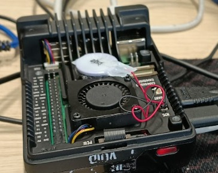
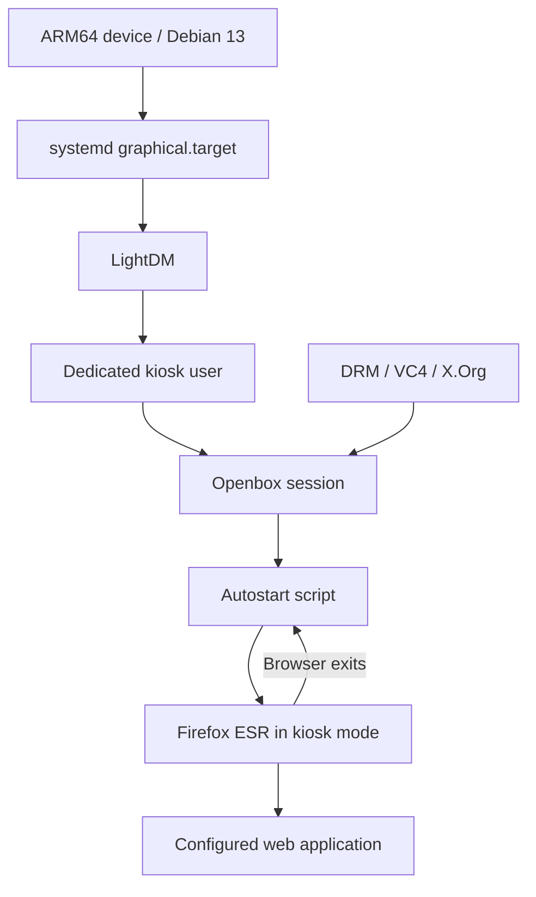

<div align="center">

# 🖥️ Raspberry Pi Enterprise Web Kiosk

**A lightweight, self-starting browser kiosk built with Debian 13, X.Org, LightDM, Openbox and Firefox ESR.**




*A sanitized portfolio case study based on a real-world workstation configuration. No internal endpoints, credentials or client identifiers are included.*

[**Setup guide**](docs/SETUP.md) · [**Architecture**](docs/ARCHITECTURE.md) · [**Troubleshooting**](docs/TROUBLESHOOTING.md) · [**Polski**](README_PL.md)

</div>

## 📖 Project overview

This project documents how I configured an **ARM64 single-board computer as a dedicated enterprise web kiosk**. The workstation boots directly into a minimal graphical session and launches a business web application in fullscreen mode without exposing a normal desktop to the operator.

The original deployment supported a browser-based enterprise data-entry workflow. This repository intentionally uses a **fictional application URL** and generic account names, making the implementation understandable without revealing the organization or its infrastructure.

> **Portfolio scope:** The repository contains public-safe configuration examples, a launcher script, troubleshooting notes and an acceptance checklist. It is **not** a full image of a production device or a ready-to-deploy, security-certified product.

## ✨ Key capabilities

| Area | Implemented approach |
| --- | --- |
| Lightweight platform | Debian 13 for ARM64, with only the packages required for the kiosk |
| Graphical stack | Linux KMS/DRM, X.Org and `modesetting` for HDMI output |
| Automatic session | LightDM starts an Openbox session for a dedicated kiosk user |
| Browser kiosk | Firefox ESR opens the configured web page in fullscreen mode |
| Continuous operation | A simple restart loop relaunches the browser after it exits |
| Screen availability | X11 screen blanking and DPMS are disabled for a continuously visible display |
| Remote maintenance | SSH and systemd tools support administration and diagnostics |
| Troubleshooting | Checks for graphical devices, display manager, session and browser processes |

## 🛠️ Technology stack

| Layer | Technology |
| --- | --- |
| Hardware | Raspberry Pi-class ARM64 single-board computer, HDMI monitor |
| Operating system | Debian 13 (ARM64) |
| Boot / services | systemd |
| Graphics | DRM/KMS, `vc4-kms-v3d`, X.Org (`modesetting`) |
| Display manager | LightDM |
| Window manager | Openbox |
| Browser | Firefox ESR |
| Automation / CLI | Bash, `xset`, optional `xdotool` for non-secret UI testing |
| Remote management | OpenSSH, `journalctl`, `loginctl` |

## 🏗️ Architecture



The system uses a **minimal graphical stack rather than a full desktop environment**. This reduces unnecessary components and keeps the device focused on its assigned task. See [Architecture and design decisions](docs/ARCHITECTURE.md).

## 🚀 Quick start (generalized example)

### Prerequisites

- Debian 13 ARM64 installed and booting successfully.
- Physical access to an ARM64 board with a functioning HDMI display.
- An administrator with `sudo` privileges.
- Network connectivity to an authorized web application.

### 1. Install packages

```bash
sudo apt update
sudo apt full-upgrade -y
sudo apt install -y \
  openssh-server xserver-xorg-core xserver-xorg-input-libinput \
  xinit lightdm lightdm-gtk-greeter openbox dbus-x11 \
  firefox-esr x11-xserver-utils xdotool curl
```

### 2. Create a dedicated user

```bash
sudo adduser kiosk
getent group autologin || sudo groupadd -r autologin
sudo usermod -aG autologin kiosk
```

### 3. Configure graphics and the session

The example files are located under [`config/`](config). Do **not** overwrite the entire `/boot/firmware/config.txt` file; merge the relevant DRM/KMS options carefully. The correct `/dev/dri/card*` device may differ between machines.

### 4. Configure a demo URL

```bash
sudo install -d -o kiosk -g kiosk -m 700 /home/kiosk/.config/kiosk
sudo install -o kiosk -g kiosk -m 600 \
  config/kiosk.env.example /home/kiosk/.config/kiosk/kiosk.env
sudo nano /home/kiosk/.config/kiosk/kiosk.env
```

Update `KIOSK_URL` with **your own authorized test URL**. The supplied `.example.invalid` hostname is deliberately nonfunctional.

### 5. Complete installation and reboot

Follow the full [step-by-step setup guide](docs/SETUP.md) to install the Openbox startup script, LightDM configuration and launcher, then enable the graphical target.

```bash
sudo systemctl set-default graphical.target
sudo systemctl enable lightdm
sudo reboot
```

> **Security warning:** Automatic OS login is appropriate only when the device, physical access, application permissions and browser session are managed according to organizational policy. **Application credential automation is deliberately omitted** from this public project.

## ✅ Verification

The [acceptance checklist](docs/ACCEPTANCE_CHECKLIST.md) covers boot, graphical devices, LightDM, browser fullscreen behavior, reboot resilience and application access. A small diagnostic helper is included:

```bash
bash scripts/kiosk-healthcheck.sh
```

The helper performs **read-only checks** and does not print passwords, application URLs or the contents of authentication files.

## 🧩 Project structure

```text
.
├── README.md
├── README_PL.md
├── .gitignore
├── assets/
│   └── raspberry-pi-kiosk.jpg
├── config/
│   ├── firmware/config.txt.snippet
│   ├── xorg/20-modesetting.conf
│   ├── lightdm/99-kiosk.conf
│   ├── openbox/autostart
│   └── kiosk.env.example
├── scripts/
│   ├── kiosk-launch.sh
│   └── kiosk-healthcheck.sh
├── docs/
│   ├── SETUP.md
│   ├── ARCHITECTURE.md
│   ├── TROUBLESHOOTING.md
│   ├── ACCEPTANCE_CHECKLIST.md
│   └── SECURITY.md
└── .github/workflows/shell-lint.yml
```

## 🔐 Security and anonymization

This public case study excludes **real usernames, passwords, internal IP addresses, corporate domains, application routes, business identifiers, screenshots containing secrets and the original confidential document**. The included configuration uses a placeholder domain reserved for examples.

The private reference configuration used browser form automation in a controlled environment. **No production login script or credentials are published here.** Modern deployments should prefer approved identity flows (for example, managed sessions or SSO) over storing reusable passwords in a shell script.

Read [Security considerations](docs/SECURITY.md) before adapting these samples. Publication of even anonymized employer-related work may require prior authorization.

## 🧪 Testing status

The original configuration procedure includes verification for X.Org, LightDM, Openbox, Firefox ESR and application availability. This public repository supplies generic templates and checks; **the templates have not been revalidated on every Debian image, Raspberry Pi revision or target application**. Paths and DRM device identifiers must be confirmed on the actual system.

GitHub Actions performs Bash syntax validation and ShellCheck static analysis for the supplied scripts.

## 💡 Skills demonstrated

- Building and troubleshooting minimal Linux graphical environments.
- Configuring KMS/DRM, X.Org, LightDM and Openbox on ARM64 hardware.
- Automating kiosk startup and recovery using Bash and systemd.
- Diagnosing problems with `journalctl`, `loginctl`, DRM devices and Linux services.
- Creating reproducible documentation, operational checklists and sanitized public artifacts.

## 🗺️ Potential improvements

- Add a watchdog or systemd user service with explicit restart and logging policy.
- Introduce managed device enrollment and centralized configuration management.
- Use approved SSO or hardware-backed identity instead of form-entry automation.
- Add network isolation, URL allowlisting and kiosk escape hardening.
- Establish automated hardware-in-the-loop tests.

---

<div align="center">

**Documentation-first portfolio case study — built to demonstrate Linux administration, endpoint management and practical troubleshooting.**

</div>
