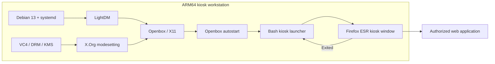

# Architecture and technical decisions

[← Home](../README.md) · [Setup](SETUP.md)

## System components

| Component | Responsibility | Reason for selection |
| --- | --- | --- |
| Debian 13 ARM64 | Base system and packages | Stable general-purpose Linux environment |
| VC4 DRM/KMS | Display kernel interface | Native graphics/HDMI support on compatible hardware |
| X.Org / modesetting | X11 display server and generic DRM driver | Compatible with Openbox and X11 automation utilities |
| LightDM | Graphical login/session startup | Lightweight display manager with configurable auto-login |
| Openbox | Window manager and autostart | Avoids a heavyweight desktop environment |
| Firefox ESR | Web application frontend | Browser kiosk/fullscreen mode |
| Bash | Restart loop and maintenance commands | Straightforward, inspectable operational logic |

## Boot sequence

1. `systemd` enters `graphical.target`.
2. LightDM launches an Openbox session for the dedicated account.
3. Openbox disables screen blanking/DPMS and starts the kiosk launcher.
4. The launcher reads a local URL configuration and opens Firefox ESR fullscreen.
5. If Firefox exits, the launcher makes another attempt after a short delay.

## Deployment boundaries

- **Device boundary:** The repository demonstrates local Linux session setup; it does not provision network switches, firewalls, ERP backends or identity systems.
- **Authentication boundary:** Operating-system autologin does not authenticate the user to the web application. The actual internal form automation has intentionally not been published.
- **Network boundary:** No internal IPs, hostnames, ports or subnet names from the original workstation are necessary to understand the project.
- **Reliability boundary:** The restart loop is a basic recovery measure, not monitoring, alerting or a hardened watchdog.

## Considerations for real deployments

Use physical security, restricted kiosk permissions, browser policy enforcement, managed updates, session logging, encrypted transport and centrally managed authentication as appropriate. The deployment owner must validate these controls rather than assuming the example configuration provides them.
